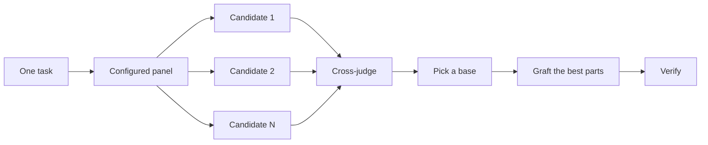

# Design before you write code

One attempt at a hard design locks in the first shape the model thought of. `$architect` settles types and boundaries before implementation. `$arena` runs several attempts at the same brief and merges the best parts. `$interrogate` has other models try to break the result. When the job is coverage rather than design synthesis, `$swarm` fans out slices or races and aggregates their results.


## Settle the shape with `$architect`

```text
$architect design the import pipeline before writing any code. i care most about how callers use it.
```

[`$architect`](../../skills/architect/SKILL.md) traces every system the change touches first. Then it sketches two different shapes, each with types, signatures, and module boundaries, and picks the one where each piece of state has one owner, each task has one way to do it, and callers need to know least. For a large or contested design, it runs `$arena` instead of sketching alone. If you want to see the design before any code, say so in the prompt.

## Fan out attempts with `$arena`

```text
$arena take my prompt to the arena verbatim. i want to compare their proposals with yours.
```

[`$arena`](../../skills/arena/SKILL.md) is the general tool underneath. N subagents attempt the same design or code brief in parallel, each writing to its own worktree or directory. A read-only judge from a different model family scores every candidate against a rubric. When no model from another family can run, the coordinator skips the judge and picks the base itself. The coordinator reads each candidate end to end, picks a base, grafts in the best ideas from the losers, and verifies the result.



The panel comes from your [`$setup-pstack`](../../skills/setup-pstack/SKILL.md) configuration, and you can adjust it per task. Ask for more candidates when the decision matters, fewer when it doesn't:

```text
$arena this, 5 candidates. the cache key format is expensive to change later.
```

## Cover slices and races with `$swarm`

```text
$swarm check every package under packages/ against its check.sh. one worker per package. one report.
```

[`$swarm`](../../skills/swarm/SKILL.md) fans N workers across independent slices, coverage matrices, gauntlet lanes, exploration partitions, or declared race arms. Each worker gets its own scope and check, then reports `PASS`, `ISSUES`, or `BLOCKED`. The parent waits for the workers and returns one compact report with any gaps or dropouts.

Reach for it when parallelism buys coverage or lets independent checks race. `$arena` gives every worker the same design or code brief, then picks a base and grafts the best parts. `$swarm` covers slices or runs a race with a selection rule declared up front. It does not use the base-selection and grafting ceremony.

## Break it with `$interrogate`

```text
$interrogate the whole branch, but skeptically. no nitpicks unless it's an actual bug or regression.
```

[`$interrogate`](../../skills/interrogate/SKILL.md) gives the change and its intent to adversaries on the configured models, and each tries to break it with a run against the real code. Adversaries find different failures. A finding survives only when rerunning its command shows a failure that breaks the intent. The report lists every verified finding with the adversaries that found it, then what each adversary dropped and why, and applies nothing.

Read the Dropped list too. You can override the verdict.

## How much design work does a task deserve?

You might be wondering whether every change needs this. No. Most changes need none of it. A rough ladder:

- A small, finished change you're unsure about needs `$interrogate` alone.
- A change that crosses function boundaries or moves ownership earns `$architect`, which brings `$arena` with it when the design is large or contested.
- A standalone decision where independent attempts would help, like naming, formats, or an algorithm, is `$arena` directly.
- A coverage matrix, set of parallel checks, or race with declared arms is `$swarm`.
- A contested design that's expensive to reverse gets `$architect`, then `$interrogate` before shipping.

`$poteto-mode` already applies this ladder. Boundary-crossing work triggers `$architect` on its own, so you reach for these directly mainly when you want more or less scrutiny than the default.

Next: [Build and clean the change](./05-build-and-clean.md).
